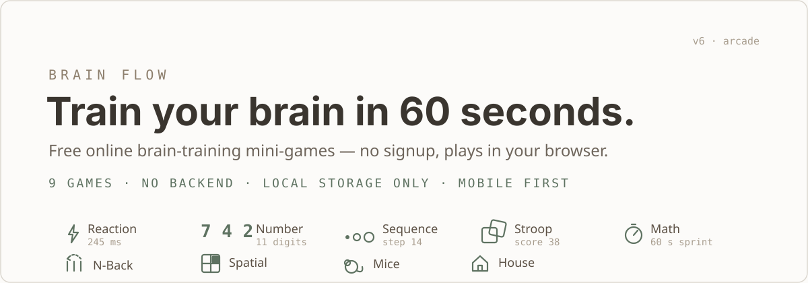
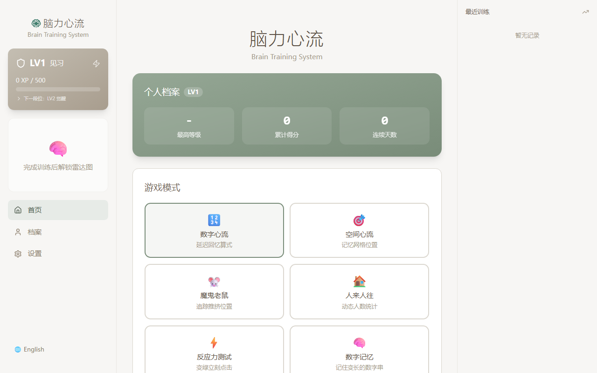
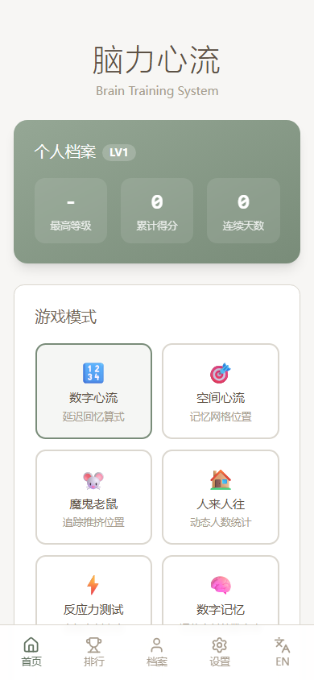
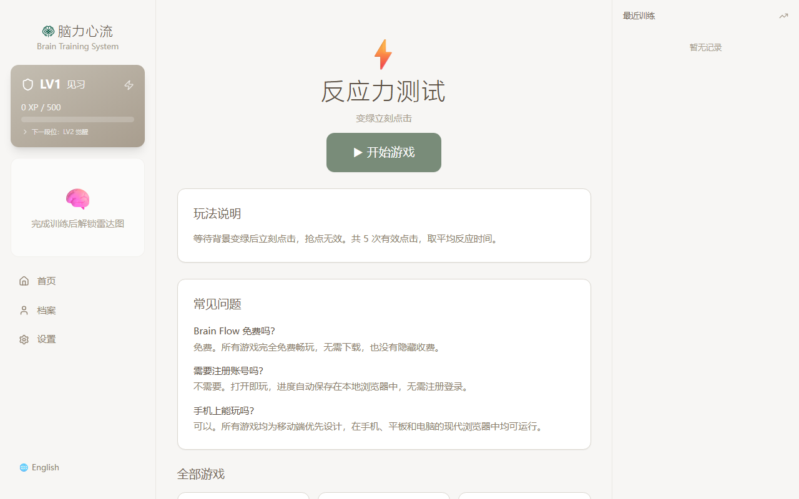
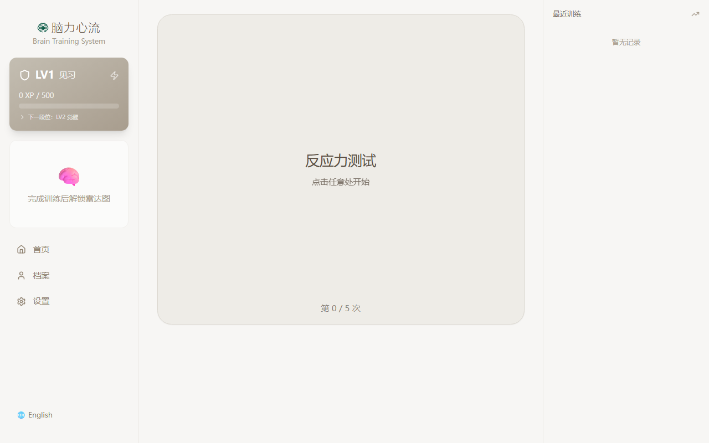

<p align="center">
  
</p>

**Brain Flow** is a guest-only arcade of nine 60-second brain mini-games. No accounts, no servers, no downloads — every score lives in your browser's local storage.

<p align="center">
  
</p>
<p align="center">
  
  
  
</p>

## The nine games

| | Game | One-line hook | Trains |
|---|---|---|---|
| ⚡ | **Reaction Time Test** | How fast are your reflexes? | reaction |
| 7️⃣ | **Number Memory** | How many digits can you hold? | working memory |
| ⠿ | **Sequence Memory** | Repeat the pattern. One more step every round. | sequencing |
| ⧉ | **Stroop Test** | Your brain lies to you. Catch it. | inhibition / focus |
| ⏱ | **Math Sprint** | 60 seconds. No calculator. | arithmetic |
| ↺ | **N-Back Challenge** | Remember the answer from N steps ago. | working memory |
| ⊞ | **Spatial Memory** | Positions fade. Your memory doesn't. | spatial recall |
| 🐭 | **Devilish Mice** | Track the mice through the shuffle. | tracking |
| 🏠 | **House Flow** | Count who's left when the door stops. | mental updating |

Every game shows a personal best, and timed games compare your result against a published typical value (sourced, never invented — e.g. reaction time median 273 ms from humanbenchmark.com's public aggregate of ≈81M samples).

## Why it's built this way

- **Zero backend by design.** A static SPA on Vercel — everything (history, XP, brain-rank radar, streaks) is computed locally and persisted to `localStorage`. No accounts to breach, nothing to scale, nothing to pay for at rest.
- **Instant play.** Landing page → playing in one tap. No onboarding questionnaire, no email wall — the deliberate opposite of the commercial brain-training funnel.
- **SEO-first distribution.** Every game has its own landing page (`/games/reaction-time-test`, …) with structured data, plus `sitemap.xml` / `robots.txt` and quiet per-game analytics copy.
- **Honest numbers.** Reference values cite their source; local stats are labelled as gameplay stats, never cognitive scores.

## Quick start

```bash
npm install
npm run dev       # local dev server
npm run build     # type-check + production build
npm run preview   # serve the production build
npm run lint
```

No environment variables, no database. Deploy is any static host (a `vercel.json` SPA rewrite is included).

## Under the hood

React 19 · TypeScript (strict) · Vite 7 · Tailwind CSS 3 (Morandi `zen`/`sage` tokens) · Zustand 5 + persist · react-router v7 · Framer Motion 12 · i18next (en/zh) · Web Audio (synthesized sounds, zero audio assets).

```
src/
├── hooks/          9 game engines (one hook each, shared hidden-tab-safe timer utils)
├── components/
│   ├── screens/    9 game screens + landing/result/profile/settings
│   ├── game/       shared arcade vocabulary: phase motion, score reveal, progress bar
│   └── layout/     responsive 3-column shell + mobile nav
├── store/          one Zustand store (configs, history, local profile)
├── lib/            SEO game catalog, heatmap, scheduleVisible timer
└── types/          all game types + rank table
```

Design docs live in [`docs/`](docs/): the pivot roadmap, the full pre-pivot code audit, an animation review, and competitor UI research.

## 中文简介

**Brain Flow(脑力心流)** 是一个免登录、无后端的网页脑力小游戏合集:9 个 60 秒小游戏(反应力测试、数字记忆、顺序记忆、色词冲突、口算冲刺、N-Back、空间记忆、魔鬼老鼠、人来人往),成绩全部保存在浏览器本地。技术栈 React 19 + TypeScript + Vite + Tailwind,纯静态部署,每个游戏有独立 SEO 落地页。详见 `docs/` 下的路线图与审计文档。

## License

Copyright © 2026 — **All rights reserved.** This repository and its code are proprietary; use, modification, or redistribution requires explicit written permission from the author (see [LICENSE](LICENSE)).
